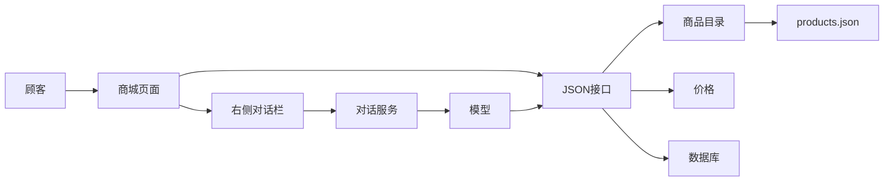

# 技术方案

状态：2026-11-13 你已澄清第 1 到 5 点。你明确说可以写代码之前，不写网页和 agent 的代码。

## 要做什么

一个 Node 服务加上 React 网页。人在商品站里浏览、加购、到确认页模拟付款。商城页面右侧有对话栏，顾客在里面打字，查商品、看报价、拿到确认页链接。用户明确要求时，对话栏也可以下单。只说加入购物车不会下单。对话栏不是另一个网页。细节见 `前端技术方案.md` 和 `后端技术方案.md`。

商品、报价、交接和确认下单都走同一组 JSON 接口。价格只在服务端算一份。



## 网页

用 React 和 Webpack。页面有商品列表、商品页、购物车、确认页。界面用简体中文，金额是整数新台币，手机上可以完成结账。

样式参考 [汪喵星球 · 最新商品](https://www.dogcatstar.com/hk/product-category/new/)。只学版式，不照搬品牌、商品和文案。该站没有的功能不做。

- 页头粘在顶部：左侧标识、横向文字导航、搜索、购物车图标。不做账号入口。
- 列表：面包屑、结果数量、排序。商品网格在桌面 4 列，较窄屏幕 2 列。卡片等高、浅阴影。图片在上，名称和价格在下。悬停时出现「加入购物车」。默认按推荐分数从高到低。
- 商品页：左侧大图，右侧名称、价格、数量和加入购物车。下方放说明、规格和评论。规格用文字列出。
- 购物车和确认页沿用同一套页头、留白和按钮。确认页列出名称、数量、单价和应付金额，不预勾加购。
- 列表、商品页、购物车和确认页的右侧都固定这条对话栏。商城内容在左。窄屏时对话栏收在当前页内，不跳转。

标价只来自商品读接口，数据源是 `data/products.json`。这一阶段页面上不出现满额减、运费和 95 折。对数据库的写操作完成后刷新当前页，页面重新请求读接口。浏览器不自己改价格或库存。

## 商品和价格接口

网页和右侧对话栏用同一组 JSON 接口，另外写一份调用说明。渠道只有 `human` 和 `agent`。人自己在商城页面买是 `human`，右侧对话栏建立的车是 `agent`。

| 能力 | 作用 | 谁可以调用 |
| --- | --- | --- |
| 读取商品 | 从 `products.json` 返回标价、库存、规格、评论 | 网页、对话模型 |
| 搜索商品 | 按名称、品牌、分类和是否有货筛选。默认 8 笔，最多 20 笔。网页列表不放单独的有货开关 | 网页、对话模型 |
| 查看商品 | 规格、库存、全部评论 | 网页、对话模型 |
| 报价 | 传入商品 id、数量和渠道，返回小计、优惠、运费、应付金额。不锁库存 | 网页、对话模型 |
| 更新购物车 | 增删商品、改数量 | 对话模型 |
| 建立交接 | 写入预留时间，锁库存 24 小时，返回确认页链接。不下单 | 对话模型 |
| 查看交接 | 打开链接时使用。过期后按当前价格和库存重算 | 确认页 |
| 确认下单 | 用户明确要下单时，对话栏可以完成。只说加入购物车时不下单 | 对话栏；确认页给人自己结账 |

加购和预留只收商品 id。P001 和 P002 同名，不能互相替换。搜索不返回毛利率，也不按毛利改排序。一次不返回全部商品。

价格规则先按 `SPEC.md` 实现，澄清后如果改了，只改服务端这一份和它的测试：

1. 小计等于单价乘数量。门槛看折前小计。
2. 小计大于或等于 1000 时减 100。
3. 渠道为 `agent` 时，再把上一步的商品金额乘 0.95，四舍五入到整数元。
4. 折前小计大于或等于 990 时运费为 0，否则运费为 100。运费不参加 95 折。
5. 应付等于折扣后的商品金额加运费。

## 右侧对话栏

对话是商城网页右侧的侧边栏，不是另一个网页。顶部由用户填写 API 和 API key，中间是对话，下面是输入框。列表、商品页、购物车和确认页都带着它。没有 API key 时不调用模型。

顾客可以用文字查商品、比较规格、要求报价，也可以让它更新购物车或下单。用户只说加入购物车时，只改购物车。用户明确要下单时，对话栏可以完成订单。

服务只用用户填写的 API key 去调用用户填写的 API。密钥不进仓库，也不预置在服务器上。模型只能调用允许的接口，不能自己编价格，也不能一次取回全部商品。

不建 MCP。外部 agent 用项目 skill 调用这组 JSON 接口。skill 写明：可以改购物车，也可以下单；只说加入购物车时不下单。

## 数据和库存

`data/products.json` 在服务启动时读入内存，运行期间不改文件。库存小于 0 视为不可售。价格为 0 可以购买。库存为 0 可以搜到，不能加入。

购物车、订单和库存预留放在服务本机的数据库。数据库随服务创建，不提交。面试官克隆后是空库，商品仍来自同一份 JSON。

确认页链接不过期。锁价和库存预留只保留 24 小时。每一笔预留保存商品 id、数量、`reserved_at` 和 `expires_at`。`expires_at` 是 `reserved_at` 加 24 小时。服务按 `expires_at` 定时释放。24 小时内打开，看到当时的报价和预留。过期后同一链接按当前目录重新计价，并检查可售量。缺货就标明缺少的商品，不换成别的商品。

可售量等于目录库存减去未过期的预留。任一商品不够时，整单拒绝。报价不产生预留。普通网页的购物车不占 24 小时预留，到确认付款时再检查库存。右侧对话栏建立交接时才预留。预留下单成功、取消或过期后释放。同一次交接重复确认，返回原来的订单，不重复扣库存。

## 已定的技术选择

现在不要按这个目录建项目。你说可以写代码之后再用。

- 网页：React 18、Webpack。开发时由 webpack-dev-server 提供页面，并把 `/api` 代理到本机服务。
- 服务：Express。商城页面和右侧对话栏都调用它。
- 商品读接口：标价从 `data/products.json` 读出。数据库写入后刷新页面，再请求这个读接口。
- 价格：服务端一个模块。网页和对话模型都不另写。
- 数据库：Node 22 自带的 `node:sqlite`。库文件不进仓库。
- 对话：对话栏顶部由用户输入 API 和 API key。服务用这把 key 调用这个 API。
- Agent 入口：JSON 接口加项目 skill。不建 MCP。

```text
client/                         React：列表、商品页、购物车、确认页，以及各页右侧对话栏
webpack.config.js
server/index.js                 JSON 接口
src/domain/catalog.js           读取并清洗商品
src/domain/pricing.js           唯一的价格实现
src/domain/pricing.test.js
src/domain/cart.js              报价、24 小时预留、确认下单
src/db.js
src/chat.js                     用用户提供的 API key 调用模型，只能走允许的接口
data/products.json
```

## 风险

| 风险 | 处理 |
| --- | --- |
| 用户只说加入购物车，模型却调用了下单 | 加购和下单是两个接口。系统提示只允许在用户明确要下单时调用下单。加购接口不能生成订单 |
| 网页和对话栏各算一遍价格 | 价格只在服务端一份实现。页面只展示接口返回的金额 |
| 写数据库之后页面仍显示旧标价或旧库存 | 写操作完成后刷新页面，重新请求商品读接口。浏览器不拿写接口的返回值改价 |
| 刷新页面把对话栏里的 API key 和对话清掉 | API 地址、API key 和当前对话放在 `sessionStorage`。标价和库存不放进去，刷新后向读接口要 |
| API key 被写进仓库、日志或模型回复 | 密钥只来自对话栏顶部，不进仓库、不进数据库、不写进日志。回复里不回显完整 key |
| 对话栏被做成独立路由 | 它是商城布局右侧的一块。列表、商品页、购物车、确认页共用，不另开页面 |
| 交接链接永久有效，库存锁却只有 24 小时 | 链接不过期。预留带 `expires_at`，到期释放。过期后打开同一链接，按当前目录重新计价并检查可售量 |
| 同一交接被连点，库存扣两次 | 一个购物车只生成一张订单。重复确认返回原来的订单 |
| P001 和 P002 同名被换成另一件 | 加购、预留、下单只认商品 id |
| 商品以后到 10 万件，一次把目录交给模型 | 搜索默认 8 笔，最多 20 笔。不提供一次返回全部商品的接口 |
| 负库存或 0 元商品被算错 | 库存小于 0 视为不可售。价格为 0 可以购买。库存为 0 可以搜到，不能加入 |
| 毛利率进了页面或被拿来改排序 | 对外响应不包含 `margin_rate`。排序只用推荐分数 |
| 人的购物车也锁了 24 小时 | 只有对话栏建立交接时预留。人自己的购物车到确认付款时再查库存 |
| 窄屏时对话栏挡住结账 | 窄屏把对话栏收在当前页内，不跳到另一个页面 |

## 实现顺序

你说可以写代码之后：

1. 商品读接口和商品网页。标价来自 `products.json`。
2. 价格接口和测试。写操作之后刷新页面，再请求读接口。
3. 右侧对话栏。顶部输入 API 和 API key。可以改购物车，也可以在用户明确要求时下单。预留带 `reserved_at` 和 `expires_at`。
4. 补 README 的启动和测试方式、真实购物记录。

## 已澄清

1. 标价从 `products.json` 经读接口给出。数据库写入后刷新页面，重新请求读接口。
2. Express 和本机 SQLite 可以用。
3. 对话栏顶部由用户输入 API 和 API key，再用这把 key 调用模型。
4. 不加 MCP，做成 skill。
5. 对话栏可以下单，但不能因为用户只说加入购物车就下单。24 小时预留要做，预留带时间字段并定时解锁。价格顺序没有改，仍是下面这一套。

价格顺序，门槛都看折前小计：

1. 折前小计大于或等于 1000，商品金额减 100。
2. 渠道为 `agent` 时，把上一步的商品金额乘 0.95，四舍五入到整数元。`human` 不乘。
3. 折前小计大于或等于 990 时运费为 0，否则运费为 100。运费不参加减 100，也不参加 95 折。
4. 应付等于折扣后的商品金额加运费。
